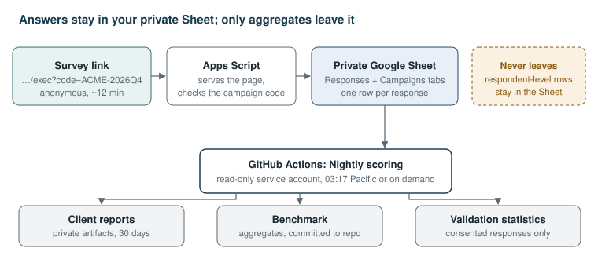
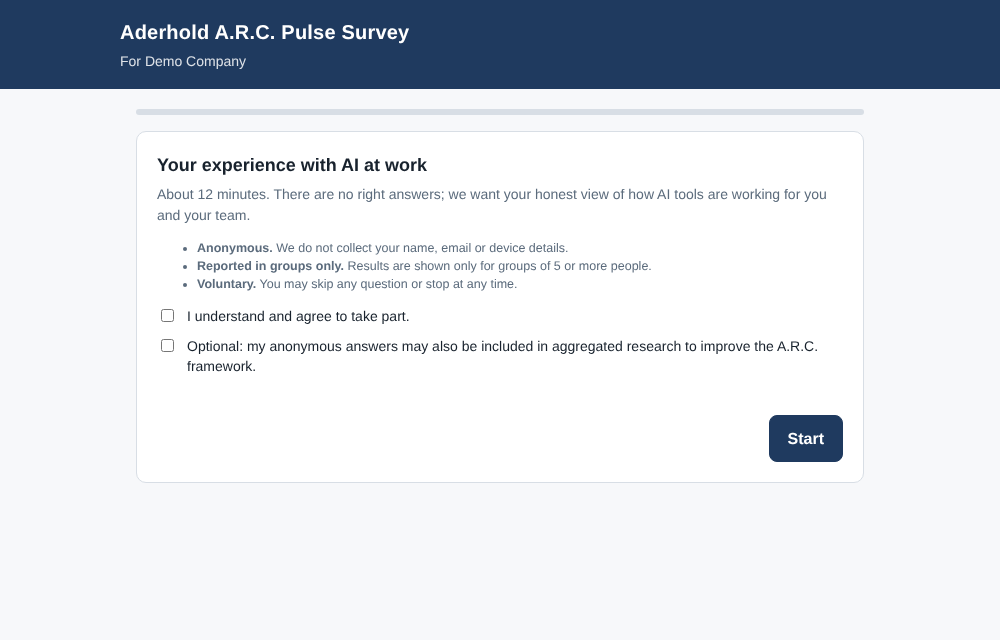
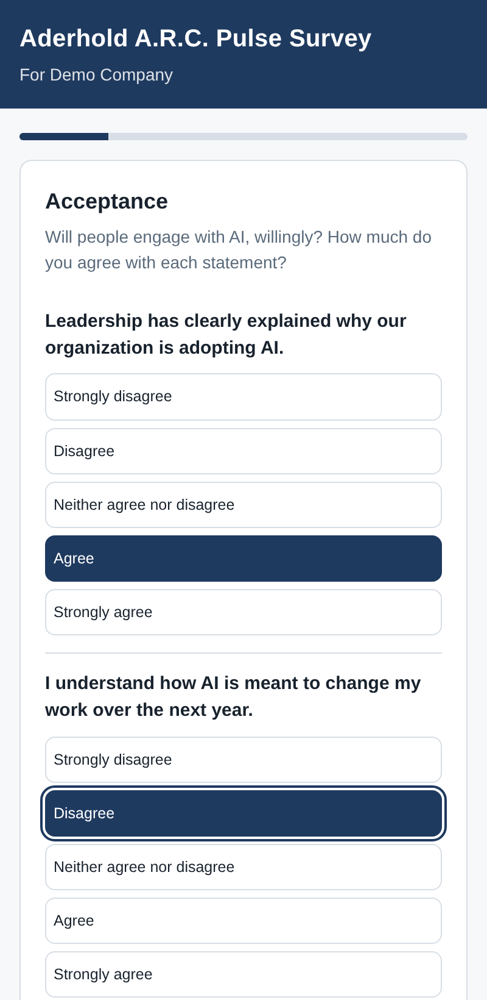
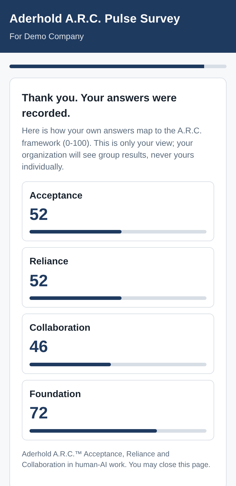
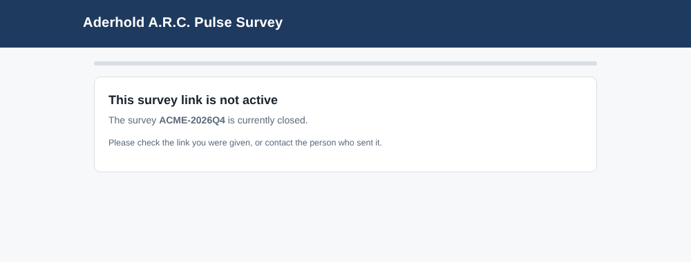
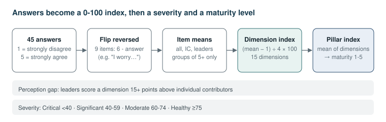
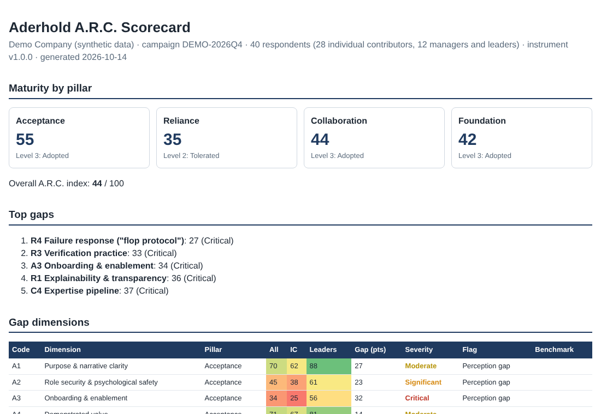
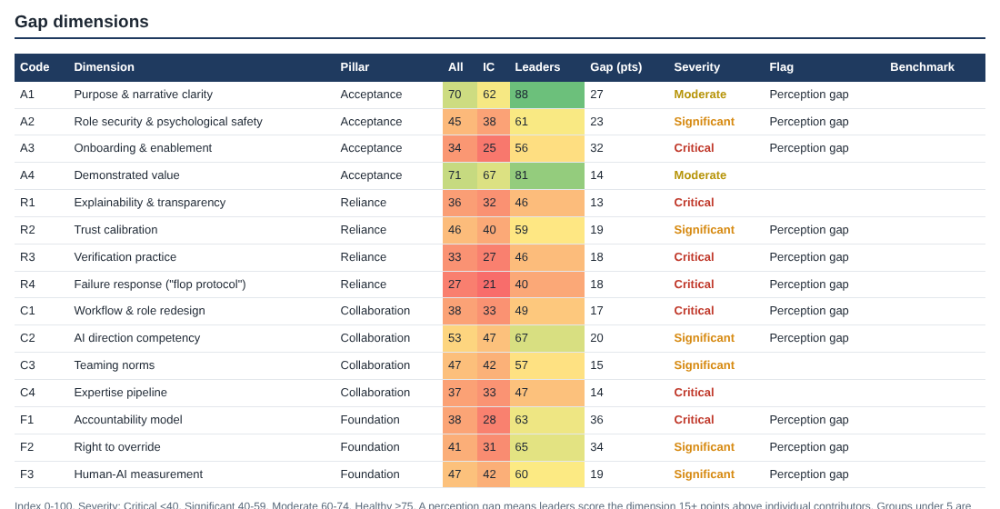
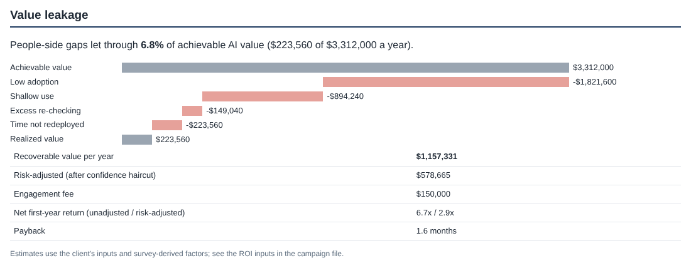
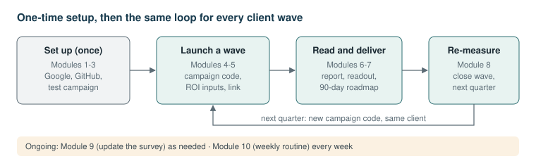

<!-- part:intro -->
This manual covers Aderhold A.R.C.: the survey, scoring engine and automation that run an A.R.C. Gap Diagnostic from the first survey link to the client readout. It has three parts:

| Part | Kind of guide | Read it when |
| --- | --- | --- |
| [1. Product guide](#part-1) | Reference | You want to know what the tool can do, and how each part works |
| [2. Training guide](#part-2) | Tutorial | You're new and want to run a diagnostic end to end, step by step |
| [3. Troubleshooting guide](#part-3) | Support | Something didn't work and you need the fix |

## How to read it

Most sections are written in three layers, so readers with different backgrounds can each stop at the depth they need:

:::plain
what it does and why it matters, without jargon. Enough for a client executive or a new team member.
:::

:::practice
the same thing in diagnostic language: dimensions, indexes, severity, value leakage, the research behind it.
:::

:::tech
the files, commands, workflows and rules involved. Enough to operate or change it.
:::

:::shot
marks a place where a screenshot of a Google or GitHub screen belongs. Those screens sit behind your sign-in, so they can't be captured automatically. The list of slots is in the [training guide's appendix](#appendix-screenshots-to-add).
:::

Every other picture in this manual comes from the demo campaign, **Demo Company (synthetic data)**, campaign code `DEMO-2026Q4`. It is the same 40-response data set as the Excel workbook.

## Keeping it current

This manual lives in the repository (`docs/manual/`) and is versioned with the engine. Screenshots of the survey and reports are captured from the demo campaign. Update the version line above when you release a new engine or instrument version, and refresh pictures whose screens have changed.

<!-- part:1 Product guide -->
What Aderhold A.R.C. does, feature by feature. Each section starts in plain language, then gives the practitioner's view, then the technical detail.

## 1. What the tool is

:::plain
Companies buy AI tools and then get a fraction of the value, because people don't use them, don't trust them the right amount, or never change how they work. This tool measures those people-side gaps with a short anonymous survey, turns the answers into scores and a dollar estimate of the value being lost, and produces a client report. It runs itself every night once it's set up.
:::

:::practice
The operational form of the A.R.C. Conceptual Framework (Aderhold, 2026). A 45-item Pulse Survey measures 15 gap dimensions across Acceptance, Reliance, Collaboration and a Foundation of human authority and accountability. Scores feed a maturity model, a perception-gap analysis (leaders vs. individual contributors) and the Value Leakage model, which estimates recoverable value. The instrument is research-based; psychometric validation accumulates automatically as consented responses arrive.
:::

:::tech
Three components. A Google Apps Script web app (`collector/`) serves the survey and appends rows to a private Google Sheet. A Python package (`arc/`) scores responses, runs the ROI model and builds reports. GitHub Actions in the private repository `Baderholdjr/aderhold-arc` run tests on every push (`ci.yml`) and score every campaign nightly (`nightly.yml`). The single source of truth for questions and scoring bands is `instrument/items.yaml`.
:::

{.wide}

**Respondent-level data never leaves the Sheet.** GitHub reads it with a read-only key, holds it in memory during the run, and keeps only group-level results.

## 2. The A.R.C. framework

:::plain
Three questions decide whether an AI rollout pays off. Will people use it willingly (Acceptance)? Do they trust it the right amount, neither blindly nor not at all (Reliance)? Has the work itself been reorganized around it (Collaboration)? Underneath sits a fourth question: are the rules on blame and overriding the AI fair (Foundation)?
:::

:::practice
Each pillar has four gap dimensions and the Foundation has three. Each dimension traces to a dissertation finding: the onboarding deficit (A3), the post-failure trust lifecycle (R4), the partner–tool continuum (C3), cognitive sovereignty and asymmetric accountability (F1, F2).
:::

| Code | Dimension | Pillar | Failure signature |
| --- | --- | --- | --- |
| A1 | Purpose & narrative clarity | Acceptance | "They're replacing us" fills the silence |
| A2 | Role security & psychological safety | Acceptance | Quiet compliance, hidden non-use, shadow AI |
| A3 | Onboarding & enablement | Acceptance | Staff learning on nights and weekends |
| A4 | Demonstrated value | Acceptance | "Neat demo, not for my job" |
| R1 | Explainability & transparency | Reliance | Outputs nobody can defend |
| R2 | Trust calibration | Reliance | Over-trust or blanket distrust |
| R3 | Verification practice | Reliance | Rubber-stamping or redoing everything |
| R4 | Failure response ("flop protocol") | Reliance | One mistake permanently collapses trust |
| C1 | Workflow & role redesign | Collaboration | AI bolted onto old process; time saved disappears |
| C2 | AI direction competency | Collaboration | Poor instructions, poor results |
| C3 | Teaming norms | Collaboration | Friction between enthusiasts and skeptics |
| C4 | Expertise pipeline | Collaboration | Juniors never build real expertise |
| F1 | Accountability model | Foundation | Blame lands on the human alone |
| F2 | Right to override | Foundation | "Pressure to agree" with the machine |
| F3 | Human-AI measurement | Foundation | Leaders fly blind |

:::tech
Dimensions, pillars and items are defined in `instrument/items.yaml` under `pillars:` and `dimensions:`. The playbook (*Aderhold A.R.C. Framework: Practitioner Playbook*) carries the full rationale, maturity descriptors and intervention catalog.
:::

## 3. The Pulse Survey

:::plain
A 12-minute anonymous survey on a phone or computer. People agree or disagree with 45 short statements, answer 8 quick questions about how they use AI, and can leave one comment. At the end they see their own scores, which only they can see.
:::

:::practice
45 Likert items (3 per dimension, 1 = strongly disagree to 5 = strongly agree), 9 of them reverse-coded. Eight behavioral items: use frequency (B1), depth of use (B2), share of saved time spent re-checking (B3), errors reaching output in 90 days (B4), training hours (B5), own-time learning hours (B6), unapproved tools (B7) and role (B8). One open question. Consent to take part is required; consent to include answers in aggregated research is a separate, optional box.
:::

:::tech
The page is `collector/Survey.html`, rendered by `doGet` in `collector/Code.gs`. Questions come from `collector/Items.gs`, which is **generated** from `instrument/items.yaml` by `python -m arc build-collector`; CI fails if it's out of date. Submissions go through `submitResponse()`, which rejects inactive campaigns, responses with under half the items answered, a missing role, and bots (a hidden honeypot field). Comments are capped at 1,000 characters and neutralized against spreadsheet formula injection.
:::

## 4. Campaigns and survey links

:::plain
Each client survey wave gets a short code, such as `ACME-2026Q4`. The code goes on the end of the survey link. Only codes you've switched on accept answers, so an old or mistyped link can't add stray data.
:::

:::practice
One campaign = one client wave. Re-measuring a client next quarter is a new campaign (for example `ACME-2027Q1`), which makes trend comparison straightforward. Codes beginning `DEMO` or `TEST` are excluded from the benchmark.
:::

:::tech
The link format is `<Web app URL>?code=<CODE>`. **Never use `?c=`**: Google reserves the parameters `c` and `sid` for Apps Script itself (see [T-01](#t-01-sorry-unable-to-open-the-file-on-every-link-with-a-code)). Codes are normalized to upper case, letters, digits, `_` and `-`, at most 40 characters. A campaign is active when its row in the Sheet's **Campaigns** tab has `active` set to a ticked checkbox, `TRUE`, `Yes`, `Y`, `1` or `Open`. ROI inputs live in the repo at `campaigns/<CODE>.yaml`.
:::

| Closed-link message | Cause |
| --- | --- |
| "This link is missing its survey code" | No `?code=` on the link |
| "The survey code … was not recognized" | Code not in the Campaigns tab |
| "The survey … is currently closed" | Campaign row is not active |

## 5. Where responses live

:::plain
Answers go straight into a private Google Sheet owned by the business account (ONI.GRC.ARC@gmail.com). Clients never see the Sheet. Nobody, including you, can tell who gave which answer.
:::

:::practice
Anonymity is designed in, not promised: no names, emails, IP addresses, device data or exact times are collected, only the date. Results for any group under 5 people are suppressed. This protects candor, which is what makes the diagnostic accurate.
:::

:::tech
The **Responses** tab holds one row per response with the columns in `ARC_INSTRUMENT.columns` (metadata, behavioral keys, 45 item ids, `open_text`, `instrument_version`). `setup()` creates the tabs and refuses to rewrite a Responses tab that already holds data with different columns. Writes use a script lock so simultaneous submissions don't collide. Data handling rules are in `docs/DATA_PROTECTION.md`.
:::

:::shot
the Sheet's **Responses** tab with a few test rows (no real client data).
:::

## 6. Scoring

:::plain
Each person's answers are turned into a score from 0 to 100 for each of the 15 gaps, then grouped into the four parts of the framework. Low scores show where the organization is losing value. The tool also flags where managers think things are fine but staff disagree.
:::

:::practice
Severity bands: **Critical** < 40, **Significant** 40–59, **Moderate** 60–74, **Healthy** ≥ 75. Maturity per pillar: 1 Imposed (0–19), 2 Tolerated (20–39), 3 Adopted (40–59), 4 Calibrated (60–79), 5 Integrated (80–100). A **perception gap** is flagged when managers and senior leaders score a dimension 15+ points above individual contributors. The top five gaps lead the readout.
:::

:::tech
`arc/scoring.py`. Reverse-coded items are flipped (6 − answer). Item means are taken per group (all, IC, leaders = MGR + SL); dimension index = (mean of item means − 1) ÷ 4 × 100; pillar index = mean of dimensions; overall = mean of pillars. Cleaning keeps a response only if it answers at least half the items, blanks values outside 1–5, and drops duplicate `response_id`s. Groups below `min_group_size` (5) return no score. The engine reproduces the Excel workbook's values exactly; `tests/test_engine.py` checks this on every push.
:::

{.wide}

## 7. The Value Leakage (ROI) model

:::plain
The tool estimates how much value the AI tools could deliver, how much is actually being realized, and what closing the gaps is worth in dollars per year. That number is what makes the business case for your engagement.
:::

:::practice
Achievable value V0 = N × H × (1 − v*) × W × T. Realized value = N × a × d × H × (1 − v) × c × W × T, where adoption *a*, depth *d* and verification drag *v* come from the survey and capture *c* is a proxy from item C1.3. Recoverable value = (target − current) + avoided error cost + avoided AI-related attrition. Proposals should quote the risk-adjusted figure (default 50% haircut).
:::

:::tech
`arc/roi.py`. Inputs per campaign in `campaigns/<CODE>.yaml` under `roi:` (start from `campaigns/_TEMPLATE.yaml`). Under `overrides:`, leave a factor as `~` to use the survey value, or type a number to override it. If there is no `roi:` block, the report is produced without the ROI section. Survey-derived factors: adoption = share answering B1 "weekly" or more; depth = mean of B2; verification = mean of B3; capture = C1.3 mean ÷ 5.
:::

| Input | Where it comes from |
| --- | --- |
| Users (N), hours saved per week (H), loaded hourly cost (W) | Client: license count, pilot data, finance |
| Working weeks (T), healthy verification share (v*) | Defaults 46 and 20%; agree with client |
| Adoption, depth, verification, capture | Survey (or override) |
| Errors per year and cost per error | Client incident log |
| Turnover, AI-attributable share, salary, replacement cost | Client HR data; assumption flagged |
| Targets, haircut, engagement fee | You |

## 8. Client reports

:::plain
For each campaign the tool produces a readout page you can open in any browser, an Excel scorecard and a data file. They show maturity by pillar, the top five gaps, all 15 dimensions color-coded, how people use AI today, and the value leakage chart.
:::

:::practice
The HTML report is the readout backbone: pillar maturity, overall index, top gaps, the dimension table (all / IC / leaders, perception gap, severity, benchmark position once five or more client campaigns exist), behavioral signals and the value waterfall with recoverable and risk-adjusted value, net first-year return and payback.
:::

:::tech
`arc/report.py` writes `reports/<CODE>/report.html` (self-contained), `scorecard.xlsx` and `scorecard.json`, plus `reports/SUMMARY.md` and `reports/benchmark_summary.json`. In GitHub they are uploaded as the run's artifact `arc-reports-<run number>` and kept 30 days. Suppressed campaigns show a warning and no scores.
:::

## 9. The nightly run

:::plain
Every night GitHub reads the Sheet, scores every campaign, and makes fresh reports. You can also run it any time with one button.
:::

:::practice
Turnaround is next morning by default, or minutes on demand during a readout week. Each run's summary lists every campaign, its response count, whether it's suppressed and its overall index.
:::

:::tech
`.github/workflows/nightly.yml`, scheduled `17 10 * * *` (03:17 Pacific daylight time) and runnable from **Actions → Nightly scoring → Run workflow**, optionally for one campaign. Steps: install, check secrets (skips with a warning if `ARC_SHEET_ID` or `GOOGLE_SERVICE_ACCOUNT` are missing), score (`python -m arc run --source sheets`), upload reports, then commit `benchmark/summary.json`. The commit step rebases and retries, and warns instead of failing if it can't push. Runners are pinned to `ubuntu-24.04`.
:::

:::shot
**Actions → Nightly scoring** run summary listing the campaigns.
:::

## 10. Benchmark across clients

:::plain
As you run more clients, the tool builds a comparison: where a client sits against others on each gap. It uses only group-level scores, never individual answers.
:::

:::practice
Each non-suppressed client campaign contributes its dimension and pillar indexes. The benchmark reports count, mean, quartiles and median. Reports show a client's position (bottom quartile to top quartile) once five or more client campaigns exist. Over time this database is your strongest competitive asset.
:::

:::tech
`arc/benchmark.py` writes `benchmark/summary.json`. Campaigns starting `DEMO` or `TEST` are excluded. The nightly run commits the file to the repo, and a copy goes in each reports artifact.
:::

## 11. Validation statistics

:::plain
To call the survey "validated", you need statistics showing it measures what it claims. The tool calculates these automatically as consented responses build up, so validation happens as a by-product of client work.
:::

:::practice
Cronbach's alpha per dimension (target ≥ 0.70) with corrected item-total correlations (items under 0.30 flagged) and alpha-if-deleted, after 30 consented responses. Horn's parallel analysis and an exploratory factor analysis (principal-axis factoring, varimax) after 200 complete consented responses, with a structure-match rate: the share of items loading with their own dimension. Publishing these results is a strong sales asset; check IRB requirements first.
:::

:::tech
`arc/psychometrics.py`, numpy only. Only respondents who ticked the research box (`consent_research = 1`) are pooled, and `DEMO` and `TEST` campaigns are excluded. Results are written into `benchmark/summary.json` under `reliability` and `structure`.
:::

## 12. The Excel workbook

:::plain
An offline Excel version of the scoring and ROI model, for workshops and for clients who send you their own survey export.
:::

:::practice
Same scoring rules and ROI formulas as the engine, with blue input cells and yellow assumptions. Useful for live ROI conversations: change an input and the value leakage updates on the spot.
:::

:::tech
`ARC_Diagnostic_and_ROI_Workbook.xlsx` (delivered separately). Paste responses into the **Responses** tab in the column order shown there. The engine and workbook produce identical results on the demo data.
:::

## 13. Data protection

:::plain
Clients' people answer honestly only if they trust the anonymity. The tool collects nothing that identifies anyone, hides small groups, and never puts individual answers in GitHub.
:::

:::practice
Contracts should cover purpose limitation, the anonymity rules, retention (raw responses deleted 12 months after the final readout unless agreed otherwise) and consent to include anonymized aggregates in the benchmark. Review comments before quoting any, and remove identifying details.
:::

:::tech
See `docs/DATA_PROTECTION.md`. `.gitignore` blocks `reports/`, data files other than `data/demo/`, `.env` files and credential JSON. The service account has Viewer access to one Sheet and read-only Sheets scope.
:::

## 14. Changing the instrument

:::plain
You can change the survey's wording or add questions, but changes must be deliberate, versioned, and kept comparable with past results.
:::

:::practice
Don't change item ids or meanings once responses exist, or benchmarks stop being comparable. Any change bumps the instrument version and starts a new Responses tab.
:::

:::tech
Edit `instrument/items.yaml`, bump `instrument.version`, run `python -m arc build-collector`, run the tests, and commit. Then rename the Sheet's Responses tab (for example `Responses v1.0.0`), paste the new `Items.gs` into Apps Script, run `setup()`, and deploy a new version. See [Module 9](#module-9-update-the-survey).
:::

## 15. Boundaries: what the tool will and won't do

| The tool will | The tool won't |
| --- | --- |
| Measure people-side gaps and estimate the value at stake | Prove causation or guarantee ROI |
| Flag where leaders and staff see things differently | Identify individuals, or let you |
| Build reports and a benchmark automatically | Decide the intervention: that's your judgment |
| Accumulate validation statistics | Claim the instrument is validated before the evidence exists |
| Keep respondent data in your private Sheet | Store raw responses in GitHub |

## Appendix A: Commands

Run from the repository folder (`pip install -r requirements-dev.txt` first).

| Command | What it does |
| --- | --- |
| `python -m arc run --source sheets` | Score every campaign from the Google Sheet (needs the two secrets as environment variables) |
| `python -m arc run --source csv --path data/demo` | Score from CSV files (default; demo data) |
| `python -m arc run … --campaign ACME-2026Q4` | Score one campaign only |
| `python -m arc run … --out reports --benchmark benchmark/summary.json` | Choose output folder and benchmark file |
| `python -m arc build-collector` | Regenerate `collector/Items.gs` from `instrument/items.yaml` |
| `python -m pytest -q` | Run the tests |

**Apps Script functions** (choose in the function menu, then **Run**):

| Function | What it does |
| --- | --- |
| `setup` | Create the Responses and Campaigns tabs and header row; safe to re-run |
| `checkSetup` | Log tabs, campaign codes, active status and deployment notes |

## Appendix B: Workflows

| Workflow | File | When it runs | What it does |
| --- | --- | --- | --- |
| CI | `ci.yml` | Every push and pull request | Tests, checks `Items.gs` is in sync, runs the demo end to end |
| Nightly scoring | `nightly.yml` | Daily 03:17 Pacific, or **Run workflow** | Reads the Sheet, scores, uploads reports, commits the benchmark |

## Appendix C: Scoring reference

| Item | Value |
| --- | --- |
| Scale | 1 Strongly disagree · 2 Disagree · 3 Neither · 4 Agree · 5 Strongly agree |
| Reverse-coded items | A2.2, A3.2, R1.3, R3.2, R3.3, R4.3, C4.2, F1.2, F2.2 |
| Index | (mean − 1) ÷ 4 × 100 |
| Severity | Critical < 40 · Significant 40–59 · Moderate 60–74 · Healthy ≥ 75 |
| Maturity | 1 Imposed · 2 Tolerated · 3 Adopted · 4 Calibrated · 5 Integrated (bands of 20) |
| Perception gap | Leaders − IC ≥ 15 points |
| Minimum group size | 5 |
| Response counted | At least 23 of 45 items answered |
| Alpha target / item-total flag | ≥ 0.70 / < 0.30 |
| EFA threshold | 200 complete consented responses |

## Appendix D: Glossary

| Term | Meaning |
| --- | --- |
| Campaign / wave | One client survey round, identified by a code such as `ACME-2026Q4` |
| Dimension | One of the 15 measured gaps (A1–F3) |
| Pillar | Acceptance, Reliance, Collaboration, or the Foundation |
| Index | A 0–100 score for a dimension or pillar |
| Perception gap | Leaders scoring a dimension 15+ points above individual contributors |
| Suppressed | Hidden because the group has fewer than 5 respondents |
| Value leakage | The difference between achievable and realized AI value |
| Verification drag | Share of AI-saved time spent re-checking or redoing outputs |
| Capture | Share of freed time redirected to valuable work |
| Research consent | The optional box allowing anonymous answers in aggregated research |
| Benchmark | Aggregated scores across client campaigns |
| Artifact | A file bundle attached to a GitHub Actions run (here, the reports) |
| Secret | An encrypted value stored in GitHub (here, the Sheet ID and service-account key) |
| Service account | A Google robot account with read-only access to the Sheet |
| Deployment / web app URL | The published version of the Apps Script survey and its `/exec` address |

<!-- part:2 Training guide -->
A step-by-step walkthrough, from first setup to a client readout, using the demo campaign. Work through it in order the first time. Each module says what you'll do, why it matters, how to do it, and how to check it worked.

You'll need:

- the business Google account (ONI.GRC.ARC@gmail.com), signed in **alone** in its own browser window or Chrome profile
- access to the repository `Baderholdjr/aderhold-arc`
- about an hour for Modules 1–3; they're one-time

You don't need a terminal. Every step can be done from Google and the GitHub website.

{.wide}

## Modules

0. [The golden rules](#module-0-the-golden-rules)
1. [Set up the survey](#module-1-set-up-the-survey)
2. [Connect GitHub to the Sheet](#module-2-connect-github-to-the-sheet)
3. [Run a test campaign](#module-3-run-a-test-campaign)
4. [Launch a client wave](#module-4-launch-a-client-wave)
5. [Set the ROI inputs with the client](#module-5-set-the-roi-inputs-with-the-client)
6. [Read a client report](#module-6-read-a-client-report)
7. [Deliver the readout](#module-7-deliver-the-readout)
8. [Close the wave and re-measure](#module-8-close-the-wave-and-re-measure)
9. [Update the survey](#module-9-update-the-survey)
10. [Your weekly routine](#module-10-your-weekly-routine)

- [Appendix: screenshots to add](#appendix-screenshots-to-add)

---

## Module 0: The golden rules

1. **Anonymity is non-negotiable.** Never ask for names, never report a group under 5, never share the raw Sheet.
2. **One account, one window.** Do all Google setup signed in only as ONI.GRC.ARC@gmail.com. Several Google accounts in one browser cause "unable to open the file" errors.
3. **The link ends `?code=`, never `?c=`.** Google reserves `c`.
4. **Change the source, not the output.** Questions live in `instrument/items.yaml`; reports are rebuilt from the Sheet every night. Editing a report is lost at the next run.
5. **After changing Apps Script, publish a new version.** A deployment keeps serving the old code until you do.
6. **Quote the risk-adjusted value.** Under-promise in proposals; the re-measure proves the rest.

## Module 1: Set up the survey

**Goal:** a working survey link that writes anonymous responses to your private Sheet.

:::plain
you create one spreadsheet and attach the survey code to it. Google then gives you a public link anyone can open without signing in.
:::

1. **Create the Sheet.** At sheets.google.com, create a blank spreadsheet named **Aderhold A.R.C. Responses**.
2. **Open Apps Script.** In the Sheet: **Extensions → Apps Script**.
3. **Paste the four files.** For each, open it on GitHub, click the copy icon at the top right of the code, and paste:
    - `Code.gs`: replace everything in the default file (`collector/Code.gs`)
    - `Items`: **+ → Script**, name it `Items` (`collector/Items.gs`)
    - `Survey`: **+ → HTML**, name it exactly `Survey`, capital S (`collector/Survey.html`)
    - `appsscript.json`: first tick **Project Settings → Show "appsscript.json"**, then replace it (`collector/appsscript.json`)

    Click **Save**.

4. **Run setup.** Choose **setup** in the function menu and click **Run**. Google warns that the app isn't verified, because it's your own script: click **Advanced → Go to (project) → Allow**.
5. **Deploy.** **Deploy → New deployment →** gear **→ Web app**. Set *Execute as:* **Me**, *Who has access:* **Anyone**. Click **Deploy** and copy the **Web app URL** (ends in `/exec`) with the **Copy** button.

    :::shot
    the **New deployment** dialog with *Execute as: Me* and *Who has access: Anyone*.
    :::

**Check it worked:**

- The Sheet now has **Responses** and **Campaigns** tabs, with `TEST-0001` active in Campaigns.
- In a private/incognito window, `<Web app URL>?code=TEST-0001` shows the welcome screen.

## Module 2: Connect GitHub to the Sheet

**Goal:** the nightly run can read the Sheet, read-only.

:::plain
you create a robot Google account that can only look at this one Sheet, and give its key to GitHub in a locked box.
:::

1. **Create a Google Cloud project.** At console.cloud.google.com (as ONI.GRC.ARC), create a project named `aderhold-arc` and select it. Skip any billing prompt; nothing here needs it.
2. **Enable the Sheets API.** Search **Google Sheets API** and click **Enable**.
3. **Create the service account.** Search **Service Accounts → Create service account**, name `arc-reader`, **Create and continue → Done** (no roles).
4. **Create a key.** Open the account → **Keys → Add key → Create new key → JSON**. A `.json` file downloads. Treat it like a password.
5. **Share the Sheet.** In the Sheet, click **Share**, paste the service account's email, set **Viewer**, untick *Notify*, and click **Share**.
6. **Add the GitHub secrets.** In the repository: **Settings → Secrets and variables → Actions → New repository secret**:
    - `ARC_SHEET_ID`: the long part of the Sheet's address between `/d/` and `/edit`
    - `GOOGLE_SERVICE_ACCOUNT`: the entire contents of the `.json` file

    :::shot
    the **Actions secrets** page listing `ARC_SHEET_ID` and `GOOGLE_SERVICE_ACCOUNT`.
    :::

7. **Delete the key file** from your computer, or store it in a password manager.

**Check it worked:** **Actions → Nightly scoring → Run workflow**. The run is green and its summary lists `TEST-0001`.

## Module 3: Run a test campaign

**Goal:** see a complete report before any client does.

1. **Submit test responses.** Open `<Web app URL>?code=TEST-0001` in a private window and complete the survey at least 10 times: at least 5 as *Individual contributor* and 5 as *People manager* or *Senior leader*, so both group columns appear. Vary your answers.
2. **Give TEST-0001 ROI inputs** (optional). In GitHub, copy `campaigns/_TEMPLATE.yaml` to `campaigns/TEST-0001.yaml` (**Add file → Create new file**, paste, edit `client:`) and commit.
3. **Run the workflow.** **Actions → Nightly scoring → Run workflow**, optionally entering `TEST-0001` as the campaign.
4. **Download the report.** Open the run, scroll to **Artifacts**, and download `arc-reports-…`. Open `TEST-0001/report.html`.

**Check it worked:** the report shows pillar maturity, top gaps and all 15 dimensions with IC and leaders columns filled. With fewer than 5 responses it says *suppressed*, which is correct.

## Module 4: Launch a client wave

**Goal:** a live, client-specific survey link.

1. **Pick a code:** client short name plus period, for example `ACME-2026Q4`.
2. **Activate it.** In the Sheet's **Campaigns** tab add a row: `code` `ACME-2026Q4`, `display_name` `Acme` (shown on the survey header), `active` `TRUE`.
3. **Create the campaign file.** In GitHub, create `campaigns/ACME-2026Q4.yaml` from `_TEMPLATE.yaml` with the client name and survey dates. ROI inputs can wait for Module 5.
4. **Test the link** in a private window: `<Web app URL>?code=ACME-2026Q4`. The header shows *For Acme*.
5. **Send it through the sponsor.** The client's executive sponsor sends the link, not you. Suggested message:

    > We're running a short, anonymous survey (about 12 minutes) on how AI tools are working for you and your team. There are no right answers. Nobody, including the consultant, can see who said what, and results are only reported for groups of 5 or more. Please complete it by [date]: [link]

6. **Plan for response rate.** Aim for 60%+ of AI-affected staff, with a reminder from the sponsor at the halfway point.

## Module 5: Set the ROI inputs with the client

**Goal:** a value estimate the client's finance team will accept.

1. **Gather the client numbers:** licensed users, loaded hourly cost, AI tool cost, expected hours saved per week (from their pilot or vendor), material AI errors per year and their typical cost, voluntary turnover and average salary.
2. **Agree the assumptions** out loud: healthy verification share (default 20%), the AI-attributable share of turnover (default 10%), targets and the confidence haircut (default 50%).
3. **Edit `campaigns/<CODE>.yaml`** under `roi:`. Leave the four `overrides:` as `~` so the survey supplies adoption, depth, verification and capture; override only with better data, such as license telemetry for adoption.
4. **Re-run** the workflow for that campaign.

:::practice
use the client's own numbers wherever they exist. A defensible conservative estimate beats a large one; the re-measure in Module 8 is what proves value.
:::

## Module 6: Read a client report

**Goal:** know what the report is telling you before you present it.

1. **Start with the pillar cards.** The lowest pillar is your headline. Level 2 (*Tolerated*) or below is common in early rollouts.
2. **Read the top five gaps.** These usually become the Activation Sprint scope.
3. **Scan the Flag column.** Every *Perception gap* is a conversation: leaders believe something is solved that staff say isn't. These land hard in readouts; present them as a shared blind spot, not blame.
4. **Check the behavioral signals.** Under 5 training hours and high own-time learning together confirm an onboarding deficit (A3). High re-checking with low R4 points to a trust collapse after errors.
5. **Read the value waterfall.** The biggest red bar is where the money is. Early rollouts lose most at adoption and depth; mature ones at re-checking and capture.

## Module 7: Deliver the readout

**Goal:** a decision on next steps.

1. **Structure (45–60 minutes):** the headline (pillar maturity and value at stake) · top gaps with the evidence · perception gaps · recommended interventions · 90-day roadmap · decision.
2. **Map gaps to interventions** using the playbook's catalog. For example: A3 → M3 Role-Based Onboarding; R3/R4 → M6 Proportionate Verification and M7 the flop protocol; F1/F2 → M11 Governance for Leaders; C2 → M8 the AI Direction Ladder.
3. **Quote the risk-adjusted value** and the engagement fee side by side.
4. **Share the report** as the HTML file or the Excel scorecard. Never share the Sheet or comments that could identify anyone.

## Module 8: Close the wave and re-measure

**Goal:** proof that the work moved the numbers.

1. **Close the wave:** set `active` to `FALSE` in the Campaigns tab. The link then shows "currently closed".
2. **Keep the final report:** download the artifact and file it with the client's engagement records; artifacts expire after 30 days.
3. **Re-measure 3–6 months later** with a new code (`ACME-2027Q1`) and the same population. Compare indexes, and put the realized-value change into the case study.

## Module 9: Update the survey

**Goal:** a change to the Apps Script code or the questions, live without breaking anything.

1. **Code-only change** (for example a fix to `Code.gs` or `Survey.html`): paste the new file into Apps Script, **Save**, then **Deploy → Manage deployments → pencil → Version: New version → Deploy**. The URL stays the same.
2. **Question change:** follow [Product guide §14](#14-changing-the-instrument). In short: edit `items.yaml`, bump the version, `build-collector`, rename the old Responses tab, paste the new `Items.gs`, run `setup`, and deploy a new version.

**Check it worked:** open a test link in a private window and confirm the change.

## Module 10: Your weekly routine

| When | What |
| --- | --- |
| Monday | Check **Actions**: last night's run is green; note any warnings |
| During a live wave | Look at response counts in the run summary; ask the sponsor for a reminder if under target |
| After a wave closes | Download the artifact; build the readout |
| Monthly | Review `benchmark/summary.json`: campaigns included, reliability status |
| Quarterly | Re-verify statistics quoted in sales materials; plan re-measures |

---

## Appendix: screenshots to add

These screens sit behind a Google or GitHub sign-in. Capture each one from your own account, save it in `docs/manual/images/` under the name given, and replace the matching "Screenshot to add" note with ``.

| # | Screen | Save as |
| --- | --- | --- |
| 1 | The Sheet's **Responses** tab with test rows | `g-responses.png` |
| 2 | Apps Script **New deployment** dialog (Web app, Me, Anyone) | `g-deploy.png` |
| 3 | GitHub **Settings → Secrets and variables → Actions** listing both secrets | `gh-secrets.png` |
| 4 | **Actions → Nightly scoring** run summary | `gh-nightly.png` |
| 5 | The run's **Artifacts** section | `gh-artifacts.png` |
| 6 | Apps Script **Execution log** after `checkSetup` | `g-checksetup.png` |

<!-- part:3 Troubleshooting guide -->
Find your symptom in the index, then follow the entry. Each entry gives:

- **What you see:** the message or behaviour
- **Why:** the cause in plain terms
- **Fix:** the steps

Entries marked **(seen in the pilot)** happened while setting up the system in October 2026, so the fix is proven.

## Before anything else

1. **Read the exact message.** The survey's closed-link page and `checkSetup` say what's wrong.
2. **Use a private window, signed in as nobody**, to test what respondents see.
3. **Find the failed step.** In **Actions**, open the failed run, click the job, then expand the step with the red ✗. The last lines usually say what happened.
4. **Re-run.** Some failures are transient (**Re-run all jobs**).

## Index

| Symptom | Entry |
| --- | --- |
| "Sorry, unable to open the file at this time" on every link with a code | [T-01](#t-01-sorry-unable-to-open-the-file-on-every-link-with-a-code) |
| "Sorry, unable to open the file" on the link `checkSetup` printed | [T-02](#t-02-the-link-ends-in-dev) |
| "Sorry, unable to open the file" only in your normal browser | [T-03](#t-03-several-google-accounts-in-one-browser) |
| Survey won't open from a Workspace or email-verified account | [T-04](#t-04-workspace-or-email-verified-account) |
| "This survey link is not active" | [T-05](#t-05-this-survey-link-is-not-active) |
| "No HTML file named Survey was found" | [T-06](#t-06-no-html-file-named-survey) |
| Changes to the survey don't appear | [T-07](#t-07-changes-dont-appear) |
| "Google hasn't verified this app" | [T-08](#t-08-google-hasnt-verified-this-app) |
| `setup` says the Responses tab has different columns | [T-09](#t-09-setup-refuses-different-columns) |
| Respondent sees "Please answer at least half…" or "Please select your role" | [T-10](#t-10-a-respondent-cant-submit) |
| Nightly run says secrets are not set | [T-11](#t-11-secrets-not-set) |
| Nightly run fails reading the Sheet | [T-12](#t-12-the-run-cant-read-the-sheet) |
| "Sheet has columns the instrument does not define" | [T-13](#t-13-unknown-sheet-columns) |
| Nightly run fails at "Commit refreshed benchmark" | [T-14](#t-14-the-benchmark-commit-fails) |
| "Node.js 20 is deprecated" warning | [T-15](#t-15-nodejs-20-deprecated) |
| Report says *suppressed* or shows *n<5* | [T-16](#t-16-suppressed-or-n5) |
| Report has no Value leakage section / "ROI skipped" | [T-17](#t-17-no-value-leakage-section) |
| CI fails: "collector/Items.gs is out of date" | [T-18](#t-18-itemsgs-out-of-date) |
| A campaign is missing from the run summary | [T-19](#t-19-a-campaign-is-missing) |
| Artifacts are gone | [T-20](#t-20-artifacts-expired) |

---

## Survey link

### T-01: "Sorry, unable to open the file" on every link with a code

**What you see:** Google's page *Sorry, unable to open the file at this time. Please check the address and try again.* on any link ending `?c=…`, even in a private window, while the bare `/exec` link opens. **(Seen in the pilot.)**

**Why:** Google reserves the URL parameters `c` and `sid` for Apps Script. Any web app link using them is rejected before your code runs.

**Fix:** use `?code=`. Make sure Apps Script has the current `Code.gs` (it reads `e.parameter.code`) and you've deployed a new version.

### T-02: The link ends in /dev

**What you see:** the same Google error, on a link ending `/dev`. **(Seen in the pilot.)**

**Why:** `/dev` is the private test link. Only the owner can open it, signed in. When `checkSetup` runs in the editor, Google reports this link.

**Fix:** get the public link from **Deploy → Manage deployments → (your deployment) → Web app URL → Copy**. It ends in `/exec` and has a different, longer ID. Don't just change `/dev` to `/exec`.

### T-03: Several Google accounts in one browser

**What you see:** the Google error in your normal browser, but the survey works in a private window.

**Why:** a known Apps Script problem when more than one Google account is signed in.

**Fix:** test in a private window, or use a Chrome profile signed in only as ONI.GRC.ARC. Respondents are rarely affected.

### T-04: Workspace or email-verified account

**What you see:** the survey won't open for outsiders when the project is owned by a Google Workspace or email-verified Workspace account. **(Seen in the pilot.)**

**Why:** Workspace sharing settings can block anonymous access. In the pilot, the root cause turned out to be [T-01](#t-01-sorry-unable-to-open-the-file-on-every-link-with-a-code), but the project was moved to a dedicated Gmail account anyway, to keep business data off personal accounts.

**Fix:** own the Sheet and Apps Script with ONI.GRC.ARC@gmail.com. If you must use Workspace: **Admin console → Apps → Google Workspace → Drive and Docs → Sharing settings → Sharing options** → allow sharing outside the organization.

### T-05: "This survey link is not active"

**What you see:** the survey's own closed page. It states the reason. **(Seen in the pilot.)**

**Fix by reason:**

- *Missing its survey code:* add `?code=<CODE>` to the link.
- *Code not recognized:* add the code to the Campaigns tab, spelled the same (case doesn't matter).
- *Currently closed:* set `active` to `TRUE` (or tick the box).

Run `checkSetup` to see exactly what the script sees.

### T-06: "No HTML file named Survey"

**What you see:** an Apps Script error mentioning `Survey`. **(Seen in the pilot:** a file was created as `survey.html`; renaming it to `Survey` prevents this error.)

**Why:** file names are case-sensitive; the code loads `Survey`.

**Fix:** in Apps Script, hover over the file, **⋮ → Rename** to `Survey`, **Save**, and deploy a new version.

### T-07: Changes don't appear

**What you see:** you pasted new code, but the live survey behaves the old way.

**Why:** a deployment serves a frozen version of your files.

**Fix:** **Deploy → Manage deployments → pencil → Version: New version → Deploy**. The URL doesn't change.

### T-08: "Google hasn't verified this app"

**What you see:** a warning when you run `setup` or deploy for the first time.

**Why:** it's your own unpublished script. Respondents never see this.

**Fix:** **Advanced → Go to (project name) (unsafe) → Allow**. The script asks only for access to this one spreadsheet.

### T-09: setup refuses: different columns

**What you see:** *Responses tab already has data with different columns.*

**Why:** the instrument changed while old responses exist. Mixing versions would corrupt scoring.

**Fix:** rename the existing tab (for example `Responses v1.0.0`) and run `setup` again.

### T-10: A respondent can't submit

**What you see:** *Please answer at least half of the statements* or *Please select your role.*

**Why:** responses with too little data can't be scored, and role drives the leaders vs. IC comparison.

**Fix:** none needed; the respondent goes back and completes it. If many people report it, check the sponsor's message explains that every question can be skipped except role.

## Nightly run

### T-11: Secrets not set

**What you see:** the run finishes with the warning *ARC_SHEET_ID / GOOGLE_SERVICE_ACCOUNT secrets are not set yet.*

**Fix:** complete [Module 2](#module-2-connect-github-to-the-sheet), step 6. Secret names must match exactly.

### T-12: The run can't read the Sheet

**What you see:** *Score campaigns* fails with `PERMISSION_DENIED`, `SpreadsheetNotFound` or `403`, or a JSON error.

**Why:** the Sheet isn't shared with the service account, the Sheet ID is wrong, the Sheets API isn't enabled, or the key was pasted incompletely.

**Fix:**

1. In the Sheet's **Share** list, check the `arc-reader@…` email is there as Viewer.
2. Check `ARC_SHEET_ID` is only the ID, not the whole URL.
3. Check the **Google Sheets API** is enabled in the Cloud project.
4. Re-paste `GOOGLE_SERVICE_ACCOUNT` with the whole file, from `{` to `}`.

### T-13: Unknown Sheet columns

**What you see:** *Sheet has columns the instrument does not define.*

**Why:** someone added or renamed a column in the Responses tab, or the Sheet is on a newer instrument than the repo.

**Fix:** undo the column change in the Sheet, or update `instrument/items.yaml` in the repo to match the deployed version.

### T-14: The benchmark commit fails

**What you see:** the run is red at *Commit refreshed benchmark*, though scoring and reports succeeded. **(Seen in the pilot.)**

**Why:** the repository changed while the run was working, so the push was rejected.

**Fix:** already fixed. The step now rebases, retries and warns instead of failing. If the warning repeats, check **Settings → Actions → General → Workflow permissions** is *Read and write*. The benchmark is still in the reports artifact.

### T-15: Node.js 20 deprecated

**What you see:** a warning that actions target Node.js 20. **(Seen in the pilot.)**

**Fix:** already fixed; the workflows use the v6 actions on Node 24. If it returns after a GitHub change, bump `actions/checkout`, `actions/setup-python` and `actions/upload-artifact` to their latest major versions.

## Reports

### T-16: Suppressed or n<5

**What you see:** *Fewer than 5 responses: results suppressed*, or *n<5* in the IC or Leaders columns. **(Seen in the pilot.)**

**Why:** the anonymity rule working as designed.

**Fix:** collect more responses. For leaders vs. IC comparisons, each group needs 5 or more.

### T-17: No Value leakage section

**What you see:** the report has scores but no ROI section, or the run log says *ROI skipped*.

**Why:** there is no `campaigns/<CODE>.yaml` with a `roi:` block, or a factor has neither a survey value nor an override.

**Fix:** create the campaign file from the template ([Module 5](#module-5-set-the-roi-inputs-with-the-client)) and re-run.

### T-18: Items.gs out of date

**What you see:** CI fails with *collector/Items.gs is out of date.*

**Why:** `instrument/items.yaml` changed without regenerating the survey's question file.

**Fix:** run `python -m arc build-collector`, commit `collector/Items.gs`, and paste it into Apps Script.

### T-19: A campaign is missing

**What you see:** a campaign with responses isn't in the run summary.

**Why:** its responses were dropped in cleaning (under half the items answered), or the code in the Sheet differs from the one you expect.

**Fix:** look at the `campaign` column in the Responses tab; codes are stored upper case.

### T-20: Artifacts expired

**What you see:** an old run's **Artifacts** section is empty.

**Why:** reports are kept 30 days, deliberately.

**Fix:** re-run the workflow for that campaign; reports rebuild from the Sheet. Download and file final reports at the end of each wave.

## When you need help

Collect: the run link (or the survey link and the exact message), what you expected, and the `checkSetup` log. Never send respondent data or the service-account key.
